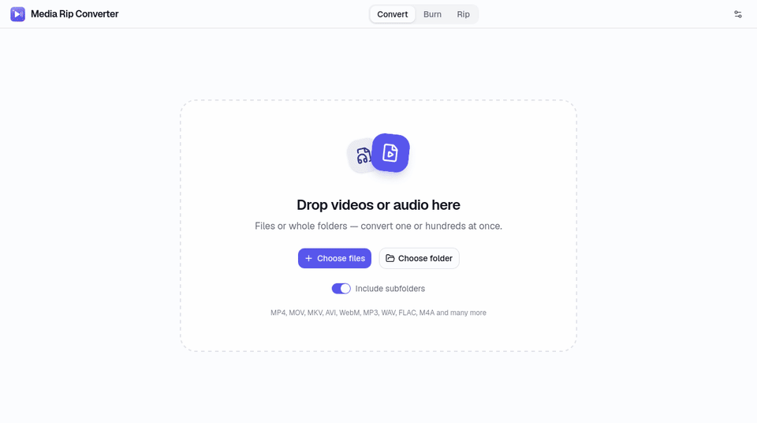
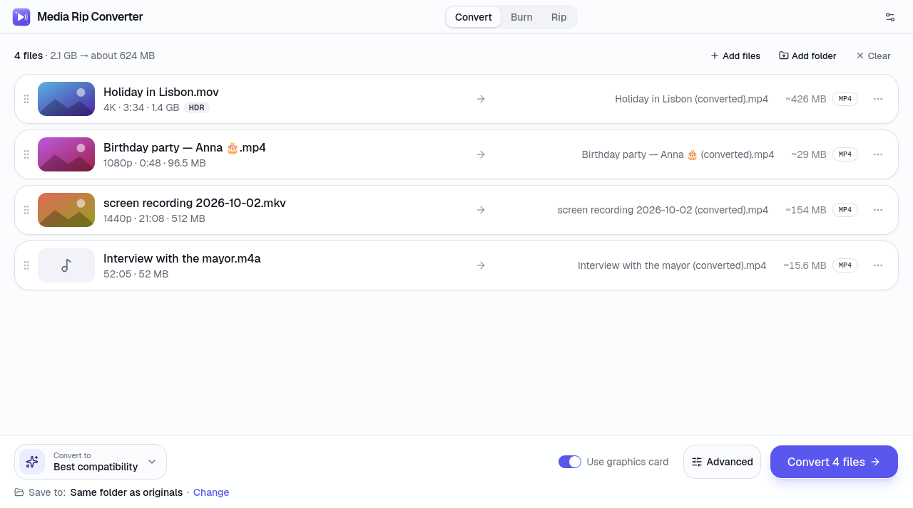
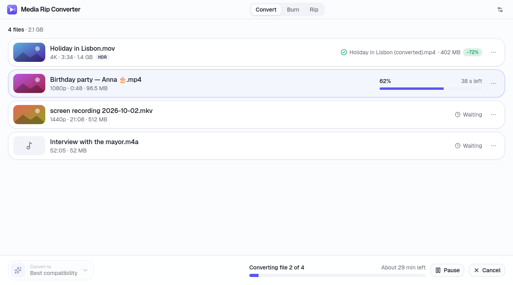
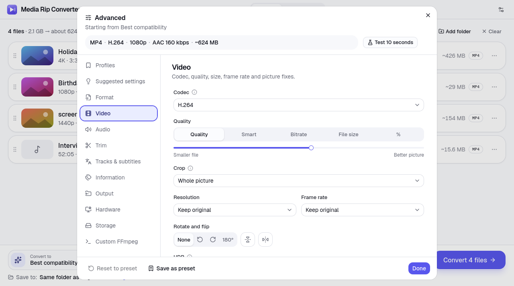
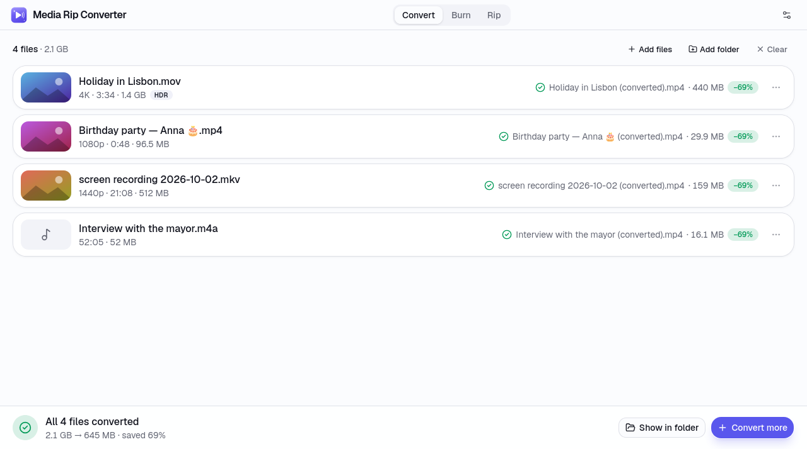
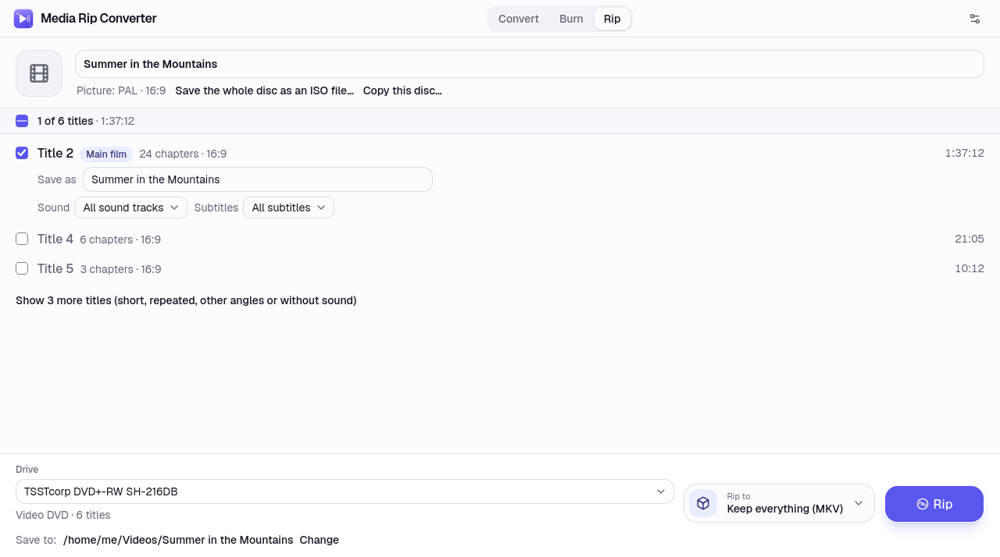
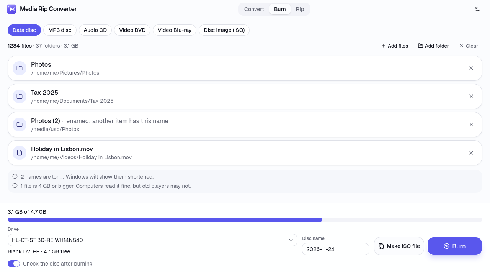
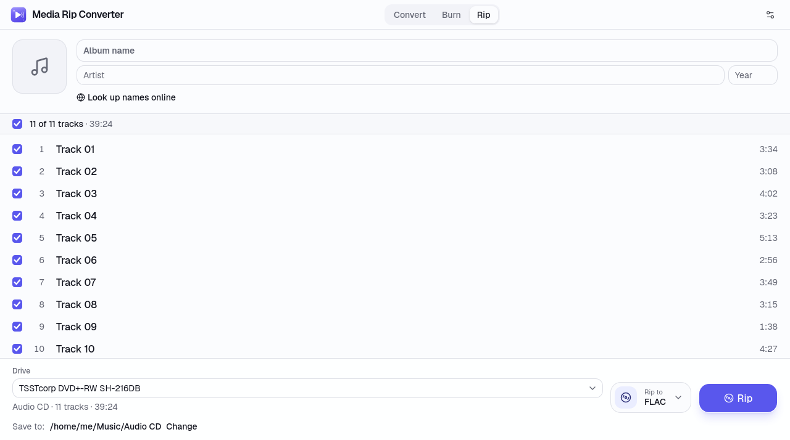
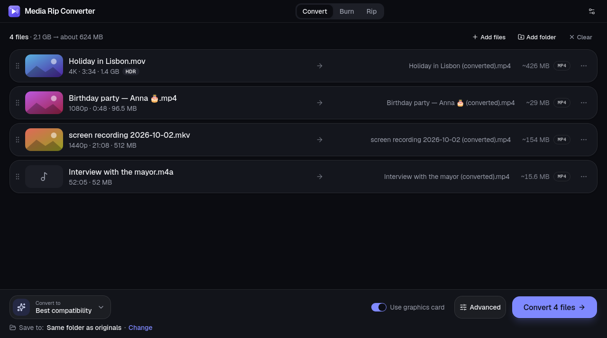

# Media Rip Converter

**Convert video and audio, burn and rip CDs, DVDs and Blu-rays. Free, simple, and it works offline.**

Pick what you want ("smaller file", "for my phone", "audio only"), drop your files in and press Convert. Everything happens on your own computer: your files are never uploaded.

  

  <a href="https://github.com/media-rip-converter/releases/releases/latest"><b>⬇ Download the latest version</b></a>
  &nbsp;·&nbsp; Windows 10/11 and Linux &nbsp;·&nbsp; free

## Which file do I download?

Open the [latest release](https://github.com/media-rip-converter/releases/releases/latest) and pick the file for your computer:

| Your computer | Download the file ending in | Then |
|---|---|---|
| **Windows 10 or 11** (64-bit) | `_x64-setup.exe` | Run it. Windows may say *"Windows protected your PC"* because the app isn't signed yet: click **More info → Run anyway**. |
| **Ubuntu, Debian, Linux Mint** | `_amd64.deb` | Double-click it to install, or `sudo apt install ./mrc_…_amd64.deb` |
| **Fedora, openSUSE** | `_x86_64.rpm` | `sudo dnf install ./mrc_…_x86_64.rpm` |
| **Any other Linux** | `_amd64.AppImage` | `chmod +x mrc_…AppImage`, then run it. The app offers to add itself to your applications menu. |

Each file comes twice, built with **FFmpeg 8.1** and with **FFmpeg 9**; the app itself is the same. If you're not sure, take **FFmpeg 8.1**. (See [the FAQ](#which-ffmpeg-81-or-9) for the difference.)

Installing a newer version replaces the old one; your settings are kept.

## What it does

### Convert
- **Simple goals:** Best compatibility, Smaller file, Same look smallest file, iPhone or iPad, Android, TV, WhatsApp & chats, Email, Web, Animated GIF, audio only (MP3, M4A, FLAC, Opus, WAV) and photos (JPEG, WebP, AVIF, PNG).
- **Many files at once**, whole folders too. Pause, resume, or let it finish in the background with a notification.
- **Graphics card encoding** (NVIDIA, AMD, Intel) when your computer has it; otherwise the processor.
- **Advanced** when you want it: codec, quality, size, frame rate, crop black bars, rotate, trim, tracks and subtitles, chapters, tags, your own FFmpeg options. Save your settings as a preset.
- **Handy extras:** split into parts, join clips into one file, turn photos into a video, burn subtitles in, test 10 seconds before converting everything, a watch folder that converts whatever you copy into it.

### Rip
- **Audio CDs** to FLAC, MP3 and more, with song names, album and cover looked up online (only if you allow it).
- **Video DVDs and Blu-rays** to video files: the main film is found for you; TV-series discs get episode names like *Show S01E05*. Keep everything (MKV) or make it smaller.
- **Copy-protected discs** (most shop-bought DVDs and Blu-rays) are read with [MakeMKV](https://www.makemkv.com/), if you install it yourself; the app helps you set it up.
- **Save a disc as an ISO file**, or copy it to a blank disc.

### Burn
- **Data discs** (CD, DVD, Blu-ray), **MP3 discs** for car stereos, **audio CDs** with song names (CD-Text).
- **Video DVDs with a menu** that play on a DVD player or TV, and **video Blu-rays**.
- **Disc images (ISO)**, and a check after burning that everything was written correctly.

## Screenshots

| | |
|---|---|
|  |  |
| *Add files, pick a goal* | *Converting, several at once* |
|  |  |
| *Advanced, when you want full control* | *Done, with how much space was saved* |
|  |  |
| *Rip a DVD or Blu-ray* | *Burn a disc* |
|  |  |
| *Rip an audio CD* | *Light and dark mode* |

## How to use it

**Convert:** open the app, drag files or folders onto the window (or *Choose files*), pick a goal at the bottom left under *Convert to*, press **Convert**. The new files are saved next to the originals with *(converted)* in the name; *Save to → Change* picks another folder.

**Rip:** put a disc in the drive and open the **Rip** tab. Untick what you don't want, pick what to rip to (*Rip to*), press **Rip**.

**Burn:** open the **Burn** tab, pick the kind of disc at the top (data, MP3, audio CD, video DVD, video Blu-ray, disc image), add files or folders, put a blank disc in, press **Burn**.

## FAQ

### Is it really free? Does it send anything?
Yes, it's free. It works without an internet connection and never uploads your files. It goes online only for two things you switch on yourself in the Settings menu (it asks you once): looking up CD song names on [MusicBrainz](https://musicbrainz.org/), and a once-a-day check here for a new version, which sends nothing but the app's version.

### Which FFmpeg, 8.1 or 9?
Both convert the same files with the same quality. The difference is only for **NVIDIA graphics cards**: with FFmpeg 8.1, encoding on the card needs NVIDIA driver **570 or newer**; with FFmpeg 9, driver **610 or newer**. Without such a driver the app simply uses the processor. When in doubt, take 8.1.

### Windows says "Windows protected your PC"
The installer isn't signed with a paid certificate yet, so Windows SmartScreen doesn't know it. Click **More info → Run anyway**. You can check the download against `SHA256SUMS` in the release (see below).

### Can it rip my shop-bought DVD or Blu-ray?
Most of them are copy-protected. The app doesn't break copy protection itself; it can use [MakeMKV](https://www.makemkv.com/) when you install it, and it guides you through that (Settings menu → *MakeMKV (copy-protected discs)…*). 4K UHD Blu-rays also need a drive that can read them.

### What do I need?
- **Windows 10 or 11**, 64-bit. Everything it needs comes in the installer, nothing is downloaded.
- **Linux**: a 64-bit system from 2022 or newer (Ubuntu 22.04, Debian 12, Fedora 36 or newer).
- For burning and ripping: a CD/DVD/Blu-ray drive. Not yet available for macOS.

### How do I uninstall it?
- **Windows:** Settings → Apps → *Media Rip Converter* → Uninstall.
- **Ubuntu / Debian:** `sudo apt remove media-rip-converter` (or remove it in App Center).
- **Fedora:** `sudo dnf remove media-rip-converter`.
- **AppImage:** in the app, Settings menu → *Remove from applications menu*, then delete the file.

### How do I check a download?
Each release has a `SHA256SUMS` file. Linux: `sha256sum -c SHA256SUMS --ignore-missing` in the download folder. Windows (PowerShell): `Get-FileHash .\mrc_…_x64-setup.exe` and compare with the line in `SHA256SUMS`.

### Something doesn't work
Please [open an issue](https://github.com/media-rip-converter/releases/issues) and say what you did, what happened, your system (Windows/Linux and version) and the app version (Settings menu → *About*). The app's error messages have a *Details* button whose text helps a lot.

## Licences

Media Rip Converter is free to use; its own code is not open source. It includes free software, run as separate programs:

- **[FFmpeg](https://ffmpeg.org/)**, under the [LGPL 2.1](https://www.gnu.org/licenses/old-licenses/lgpl-2.1.html) (an LGPL build: no GPL or non-free parts).
- **Disc tools:** xorriso, cdrskin, cdparanoia, dvdauthor, spumux, genisoimage (GPL) and tsMuxeR (Apache 2.0).

Their complete source code is attached to every release (`ffmpeg-source-….tar`, `disc-tools-source….tar`), and the licence texts are inside the app (Settings menu → *About*).
